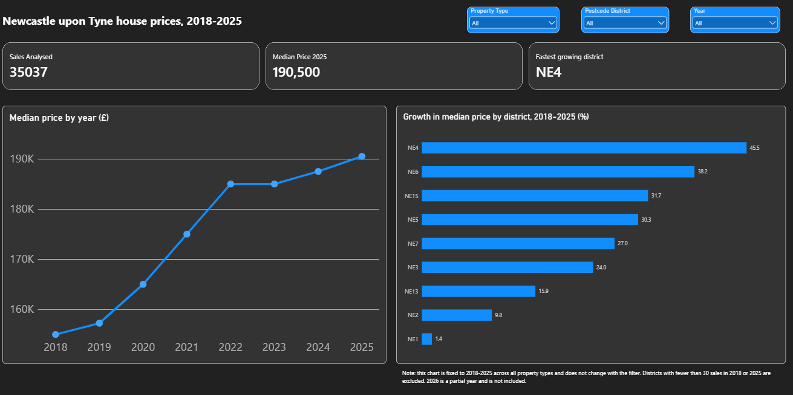

# Which Newcastle districts gained value fastest? House prices 2018-2025

An end-to-end analysis of HM Land Registry sales data for Newcastle upon Tyne, built with Python, SQL, Excel and Power BI.



## Question

Between 2018 and 2025, which postcode districts in Newcastle upon Tyne saw the fastest growth in median house prices?

## Key findings

1. **NE4 grew fastest**: median price rose from £110,000 to £160,000 (+45.5%, about 5.5% a year), followed by NE6 (£125,000 to £172,750, +38.2%).
2. **NE1 (city centre) barely moved**: £138,000 to £140,000 (+1.4%), with the number of sales falling from 145 to 112.
3. **Across the city**, the median price rose from £155,000 in 2018 to £190,500 in 2025 (+22.9%).

## Method

| Step | Tool | What I did |
|---|---|---|
| 1. Filter | Python (pandas) | Read 9 yearly Price Paid files (2018-2026) in chunks and kept sales in the Newcastle upon Tyne district: 39,916 rows |
| 2. Clean | Python (pandas) | Removed deleted records, duplicate transaction IDs, missing postcodes, "other" property types, prices below £10,000 and extreme outliers (3 x IQR per property type): 36,753 rows. Decisions are logged in `cleaning_log.md` |
| 3. Analyse | SQL (SQLite) | Median price by district and year, growth ranking with `RANK()`, sales priced well below the district average (CTE), property mix check |
| 4. Validate | Excel | Recalculated the medians independently from the raw sales and compared them with the SQL results |
| 5. Visualise | Power BI | KPI cards, price trend, district growth ranking, filters |

Growth is calculated from 2018 to 2025 because 2026 is a partial year (data runs to 27 August 2026). Only districts with at least 30 sales in both years are ranked.

## Validation

The SQL medians were recalculated independently in Excel from the raw sales table and compared row by row (`check_median` sheet in `excel/`).

- All 103 district-year medians match the SQL results exactly (total absolute difference: 0).
- All 103 sales counts also match.

## Limitations

- Prices are **not adjusted for inflation**, so growth is nominal.
- Median price is affected by property mix (flats vs houses). The city centre (NE1) is mostly flats, so its trend is not directly comparable with suburban districts. See `sql/04_property_mix_check.sql`.
- Small districts (fewer than 30 sales in 2018 or 2025) are excluded from the ranking.
- Land Registry records sale prices, not valuations, and covers postcode districts, not individual neighbourhoods.

## Repository structure

```
notebooks/   Python: filter, clean, load into SQLite
sql/         Analysis queries (run in numeric order)
data/clean/  Cleaned sales and SQL result tables
excel/       Validation workbook
dashboard/   Power BI file (.pbix)
images/      Dashboard screenshot
cleaning_log.md
```

## How to reproduce

1. Download the yearly Price Paid Data files from HM Land Registry and save them as `data/raw/pp-2018.csv` ... `pp-2026.csv` (raw data is not included in this repo).
2. Run the notebooks in `notebooks/` in order (01, 02, 03).
3. Run the queries in `sql/` in order (02 needs the view created by 01).
4. Open `dashboard/newcastle_dashboard.pbix` in Power BI Desktop.

## Data source

Contains HM Land Registry data © Crown copyright and database right. This data is licensed under the [Open Government Licence v3.0](https://www.nationalarchives.gov.uk/doc/open-government-licence/version/3/).
